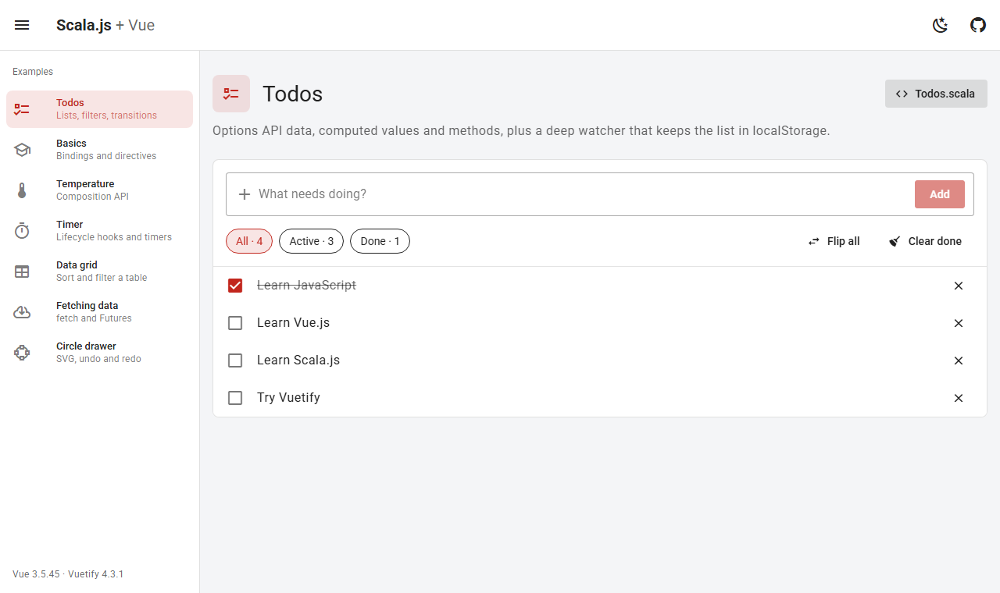
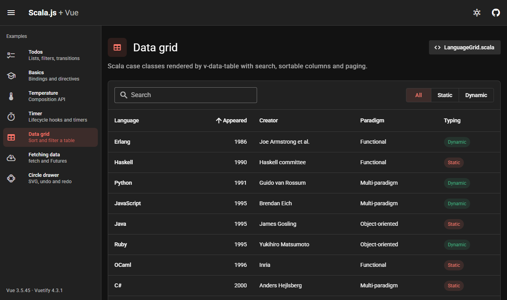
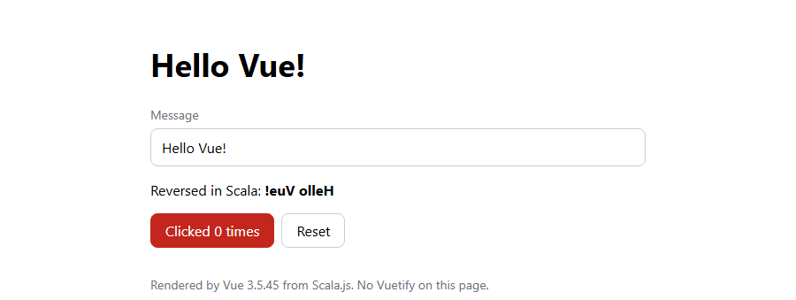
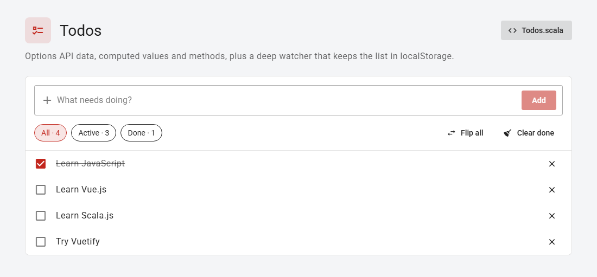
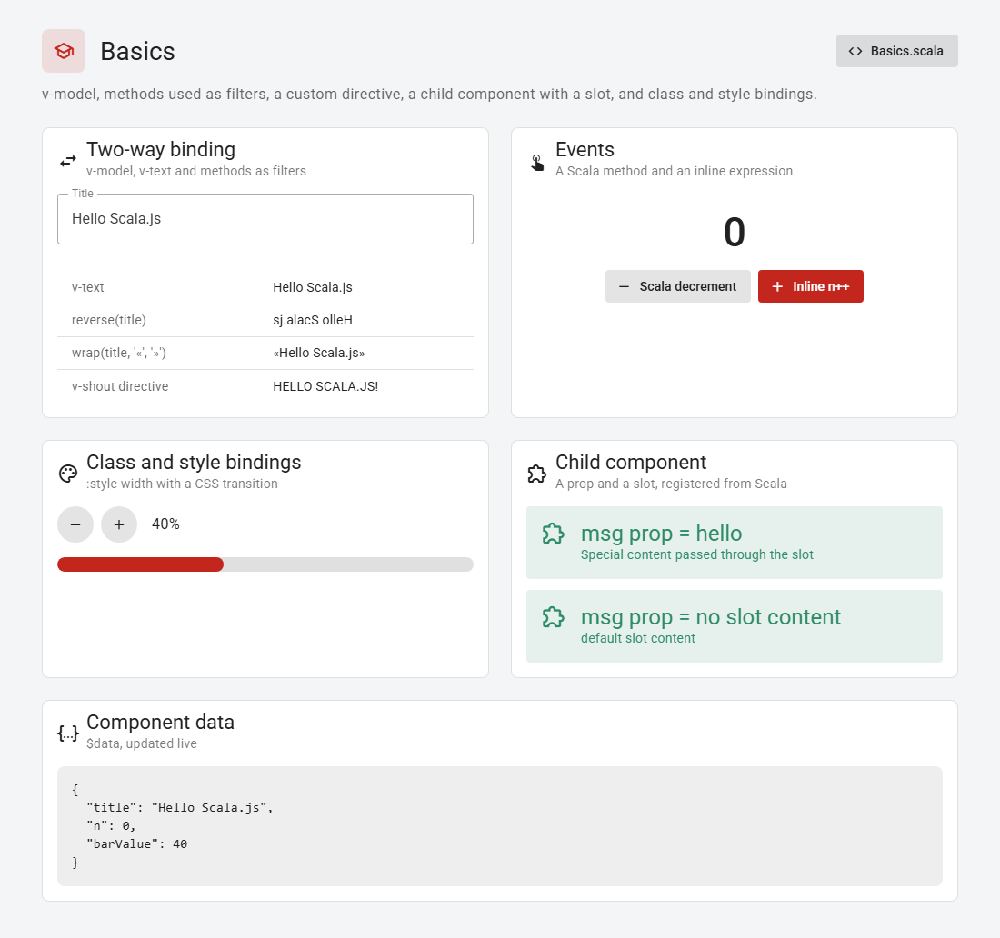
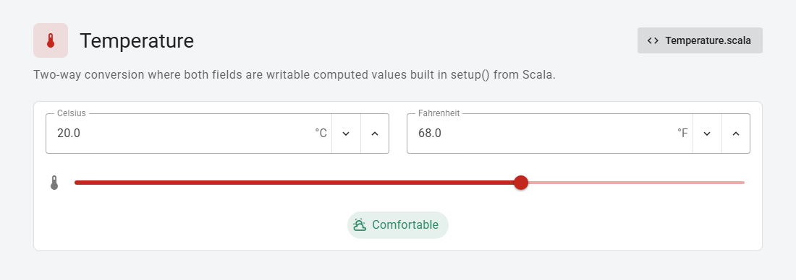
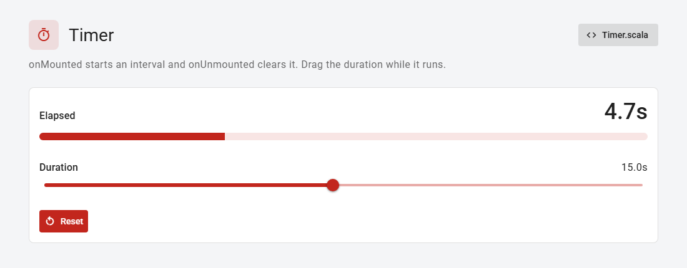
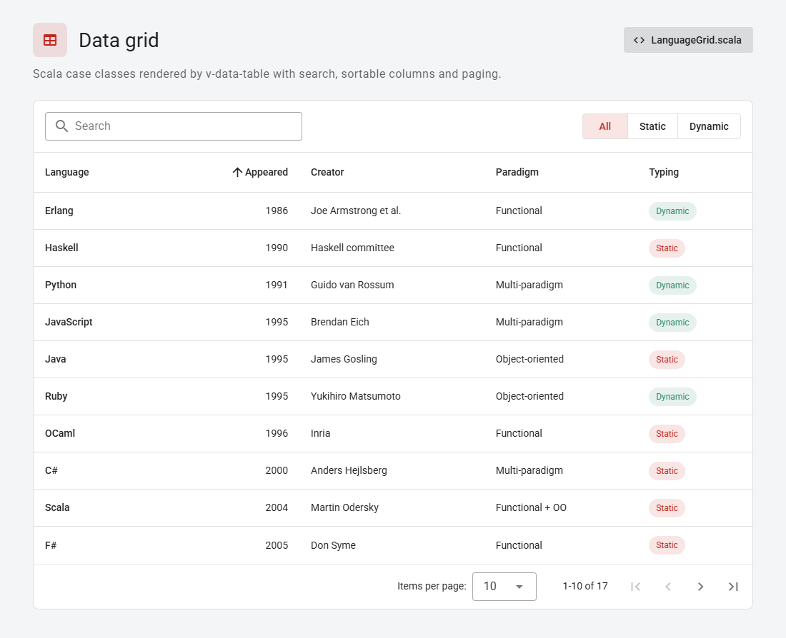
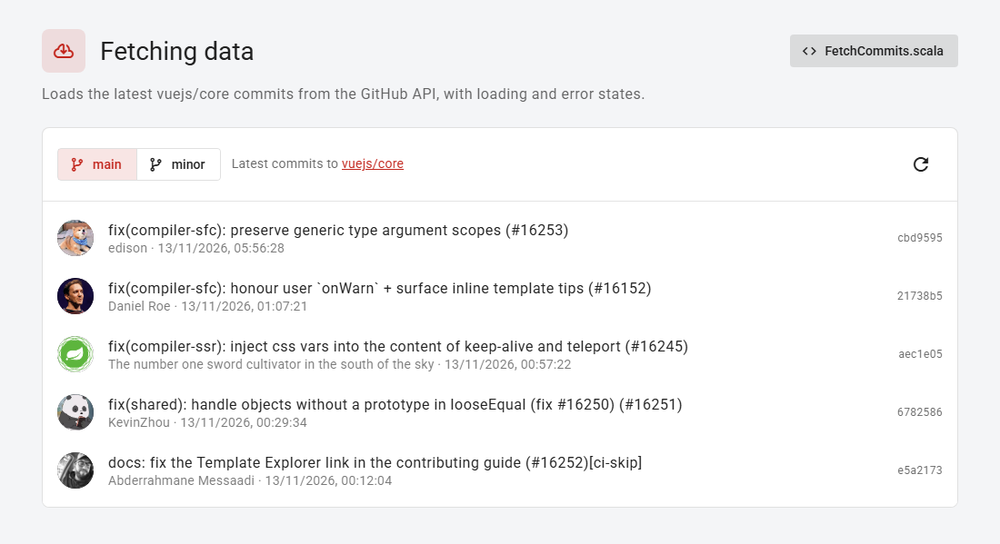
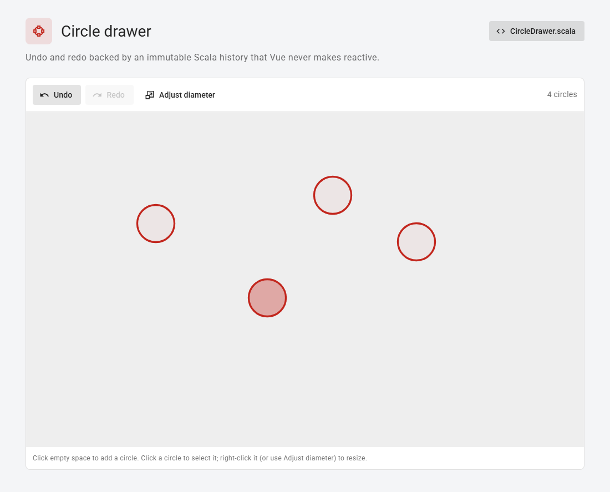

# Examples

Every example is one self-contained Scala file, template included, and each one can be run on its own
from sbt. Several are based on the [Vue.js examples](https://vuejs.org/examples/) and the
[7GUIs](https://eugenkiss.github.io/7guis/) tasks.

| Example | Run it | Package | What it shows |
| --- | --- | --- | --- |
| [Hello World](#hello-world) | `sbt demoHello` | plain | Vue only: refs, a computed value, v-model |
| [Todos](#todos) | `sbt demoTodos` | vuetify | Options API, deep watcher, localStorage |
| [Basics](#basics) | `sbt demoBasics` | vuetify | Bindings, a custom directive, a child component with a slot |
| [Temperature](#temperature) | `sbt demoTemperature` | vuetify | Composition API, writable computed values |
| [Timer](#timer) | `sbt demoTimer` | vuetify | `onMounted` / `onUnmounted` lifecycle hooks |
| [Data grid](#data-grid) | `sbt demoGrid` | vuetify | Scala case classes in a sortable, searchable table |
| [Fetching data](#fetching-data) | `sbt demoFetch` | vuetify | `dom.fetch` and Scala `Future`s |
| [Circle drawer](#circle-drawer) | `sbt demoCircles` | vuetify | SVG, undo/redo over an immutable Scala history |

Each `demo…` command links the JavaScript, serves it on `localhost:12345`, opens your browser on a page
with just that example, and relinks whenever you save. Add `-Ddemo.browser=false` to open it yourself
(the URL is printed). `sbt "demo <name>"` does the same, and in the sbt shell `demo <TAB>` lists the names.

## The gallery

`sbt dev` (or `sbt demoGallery`) serves all the Vuetify examples in one app with a navigation drawer,
a light/dark toggle and a link per example (`#/timer` and so on). It's built in
[vuetify/Main.scala](src/main/scala/example/vuetify/Main.scala), exported to JavaScript as `ScalaVue.main`.

## Plain Vue

These live in [`src/main/scala/example/plain`](src/main/scala/example/plain). Their pages load Vue and
nothing else, so they're the place to start if you don't want Vuetify.

### Hello World

`sbt demoHello` · [HelloWorld.scala](src/main/scala/example/plain/HelloWorld.scala) · page `hello-dev.html`

- `setup()` returns two `Vue.ref`s, a `Vue.computed` that reverses the message in Scala, and a reset function.
- The template binds them with `v-model`, `{{ }}` and `@click`.
- Exported to JavaScript as `HelloWorld.main("#app")`; styled with a few lines of plain CSS (`hello.css`).

## Vuetify

These live in [`src/main/scala/example/vuetify`](src/main/scala/example/vuetify). Their templates use
[Vuetify 4](https://vuetifyjs.com/) components, which the pages load from a CDN along with Vue.
Run on their own, they use `demo-dev.html?demo=<name>` (`ScalaVue.single`).

### Todos

`sbt demoTodos` · [Todos.scala](src/main/scala/example/vuetify/Todos.scala)

- Options API: `data`, `computed` (`remaining`, the filtered `visible` list) and `methods`, each a Scala function taking the component instance.
- A deep `watch` on `todos` saves the list to localStorage, so it survives a reload.
- Plain `push`, `splice` and assignment are reactive in Vue 3; no `Vue.set` needed.

### Basics

`sbt demoBasics` · [Basics.scala](src/main/scala/example/vuetify/Basics.scala)

- `v-model`, `v-text`, and methods standing in for Vue 2's filters (`reverse(title)`, `wrap(title, …)`).
- A custom directive (`v-shout`) and a child component with a prop and a slot, both registered locally from Scala.
- A Scala click handler next to an inline expression, and `:class` / `:style` bindings.
- `$watch` from Scala logs every title change to the console.

### Temperature

`sbt demoTemperature` · [Temperature.scala](src/main/scala/example/vuetify/Temperature.scala)

- Composition API: `setup()` builds the state with `Vue.ref` and `Vue.writableComputed`.
- Both number fields are writable computed values over one Celsius ref, so editing either updates the other.
- A Scala pattern match turns the temperature into the label under the slider.

### Timer

`sbt demoTimer` · [Timer.scala](src/main/scala/example/vuetify/Timer.scala)

- `Vue.onMounted` starts a `js.timers.setInterval`; `Vue.onUnmounted` clears it, so leaving the page stops it.
- The interval handle is a plain Scala `var` captured by those closures.
- Dragging the duration while it runs extends or shortens the countdown.

### Data grid

`sbt demoGrid` · [LanguageGrid.scala](src/main/scala/example/vuetify/LanguageGrid.scala)

- The rows start as Scala case classes and are converted to plain JS objects for Vuetify's `v-data-table`.
- The table does searching, sorting and paging; a computed value in Scala adds the Static / Dynamic filter.
- On phones the table switches to one card per row.

### Fetching data

`sbt demoFetch` · [FetchCommits.scala](src/main/scala/example/vuetify/FetchCommits.scala)

- Loads the latest commits to vuejs/core from the GitHub API with `dom.fetch`, chained as Scala `Future`s.
- A `watch` on the branch (with `immediate`) reloads; only the newest request may update the page.
- Shows a skeleton while loading and a readable error if the request fails. GitHub allows 60
  unauthenticated requests an hour per visitor.

### Circle drawer

`sbt demoCircles` · [CircleDrawer.scala](src/main/scala/example/vuetify/CircleDrawer.scala)

- Click to add a circle, click one to select it, right-click (or Adjust diameter) to resize it in a dialog.
- Undo and redo work over an immutable Scala history (`List`s of `Vector[Circle]`), held outside Vue's
  reactivity with `Vue.markRaw`; after each change the current circles are copied into reactive data.
- A resize previews live while you drag and becomes a single undo step when the dialog closes.

## Adding an example

- **Vuetify:** write a component in a new file under `src/main/scala/example/vuetify` (copy one of the
  existing ones), add an `Example(...)` entry for it in `Main.scala`, and add its id to `demos` in
  `build.sbt` to get a `demo<Name>` shortcut.
- **Plain:** write an object under `src/main/scala/example/plain` with an exported `main(selector)`, give it
  a page like `hello-dev.html` (and its `-opt` twin), and add it to `demos` in `build.sbt`.
